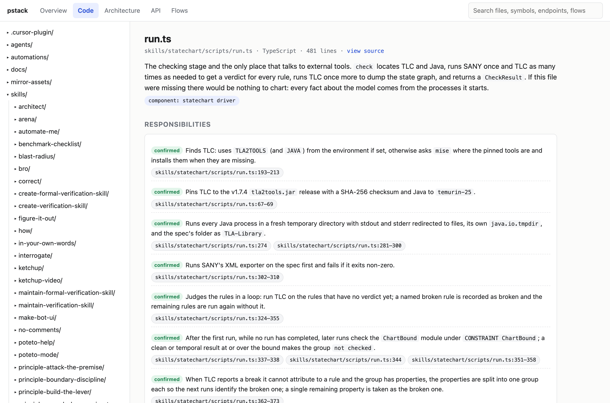

# Codebase Explorer

English | [中文](README.zh-CN.md)

An Agent Skill that has your AI coding assistant read an unfamiliar repository and turn it into a static documentation site you can browse. Every statement on the site points at specific source lines and says how certain it is.

It is not built to answer "what does this file do". It is built for the hardest question about unfamiliar code: "how do these files work together to do one thing".


<sub>The screenshots come from running the skill on [pstack](https://github.com/backnotprop/pstack) with English output.</sub>

## Why this exists

Getting an AI to explain code is easy. Trusting the explanation is the hard part. In generated documentation, a correct sentence and a plausible invented one look the same. This skill handles that with two rules.

**Scripts own structure, the model owns meaning.** File lists, symbols, line numbers, signatures, imports and HTTP routes all come from bundled scripts that parse the code. The model may not retype or guess them. The model does what a parser cannot: say what a module is responsible for, why a function exists, which business rule a branch implements, and how a request travels through the system.

**Every claim carries its evidence and its certainty.** Each statement cites source lines and has one of three statuses:

| Status | Meaning |
|---|---|
| `confirmed` | The cited lines (or parser output) show it directly |
| `inferred` | A reasonable reading that the cited lines do not prove alone, such as which implementation a dependency-injected interface resolves to |
| `unknown` | The evidence is not in the repository. This is stated, not filled with a guess |

A validator checks every reference mechanically: the file exists, the line range is inside the file, and any quoted snippet really occurs in those lines. A reference that does not hold up shows as an error in the report.

## What the site looks like

A codebase has three structures that do not map one-to-one, so the site has three linked views:

- **Code** (physical): the file tree, with an explanation per file and symbol.
- **Architecture** (logical): components, and who depends on whom and why.
- **Flows** (business): one operation traced step by step across files from its trigger, including the branches that change the outcome and the places where the trail leaves the repository. Every entry point gets one, and an entry-point table shows what each trigger does and links to its flow.

A flow crosses many files and a file serves many flows, so the views link to each other instead of being forced into one hierarchy. There is also an **API** view listing the extracted HTTP routes.



The site is one self-contained `index.html`: no build step, no network access, and it opens straight from disk. Clicking any evidence reference opens the source on the right with the cited lines highlighted.

## Install

You need:

- An AI coding assistant that supports [Agent Skills](https://agentskills.io) (Claude Code, Codex and others).
- Python 3.9 or later. The scripts use the standard library only, so there is nothing to install.

Claude Code:

```bash
git clone https://github.com/RessCris2/codebase-explorer ~/.claude/skills/codebase-explorer
```

Codex and other tools that read `~/.agents/skills`:

```bash
git clone https://github.com/RessCris2/codebase-explorer ~/.agents/skills/codebase-explorer
```

To update, run `git pull` in that directory.

## Usage

Open your assistant in the repository you want to understand and say what you want:

```
Help me read this source code
Explain how this repo works
How does a checkout request flow through this codebase?
```

You can also invoke it explicitly with `/codebase-explorer`.

If you ask a specific question (for example "how does the agent call the shell tool?"), that question becomes the first flow to be traced and decides which code is read first.

When it finishes, the assistant tells you:

- the path to open, by default `./codebase-docs/<repo-name>/dist/index.html`
- the scope it covered and what it left out
- the coverage numbers and how many claims are confirmed, inferred and unknown
- the most important gaps

### Output language

The prose and the site interface are **Chinese by default**, whatever language you talk to the assistant in. For English, ask for it explicitly, for example "in English" or "write the output in English".

Identifiers, file paths and snippets copied from source are always left as they are.

## How it works

The skill takes the assistant through six phases. Scripts do four of them.

| Phase | Done by | What happens |
|---|---|---|
| 1. Discover | `scripts/scan_repo.py` | Walks the repository and writes a manifest: languages, line counts, framework hints, entry-point hints, and which files were excluded and why |
| 2. Extract | `scripts/extract_python.py` | Parses Python files with `ast`: symbols with exact line ranges, imports, best-effort call edges, FastAPI / Flask routes, Pydantic-style models |
| 3. Explain modules | The model | One explanation per file, starting with leaf modules that import nothing else from the repository |
| 4. Reconstruct architecture, API and flows | The model | Groups files into components, adds purpose and error cases to endpoints, lists every entry point (routes, commands, jobs) in a catalog and traces a flow for each one, splitting the work across subagents when there are many |
| 5. Validate | `scripts/validate_docs.py` | Checks every reference and reports errors and coverage gaps |
| 6. Build | `scripts/build_site.py` | Bundles the manifest, code graph, docs, validation report and source text into one HTML file |

Depth depends on the size of the repository:

| Code size | Scope |
|---|---|
| Up to about 15k lines | Every code file is explained |
| About 15k to 80k lines | Every file gets a summary; core packages get symbol-level detail |
| Larger | The assistant asks which subsystem matters, or picks the core by entry points and most-imported modules, and says what it left out |

The output directory:

```
codebase-docs/<repo-name>/
├── data/
│   ├── manifest.json            # phase 1: file inventory
│   ├── code_graph.json          # phase 2: symbols, imports, routes (Python only)
│   └── validation_report.json   # phase 5: validation result
├── docs/
│   ├── overview.json            # summary, scope, reading guide
│   ├── architecture.json        # components and dependencies
│   ├── api.json                 # endpoint descriptions
│   ├── flows.json               # flows
│   └── modules/*.json           # one explanation per file
└── dist/
    └── index.html               # the site
```

The format of the files under `docs/` is described in [references/schema.md](references/schema.md).

### Updating an existing site

After the code changes, have the assistant run again on the same output directory. It rescans and re-extracts, then runs the validator first: the errors it reports are exactly the claims that went stale because the code moved. Those get fixed, new files get documented, and the site is rebuilt.

## Running the scripts yourself

The scripts do not depend on any AI assistant:

```bash
OUT=./codebase-docs/my-repo

python3 scripts/scan_repo.py /path/to/repo --out $OUT   # writes data/manifest.json
python3 scripts/extract_python.py --out $OUT            # writes data/code_graph.json
# ... write the docs under $OUT/docs/ following references/schema.md ...
python3 scripts/validate_docs.py --out $OUT             # exits 1 if there are errors
python3 scripts/build_site.py --out $OUT                # writes dist/index.html
```

Options for `build_site.py`:

- `--lang zh|en`: interface language. It follows `lang` in `overview.json` by default and falls back to Chinese. It switches the interface only and does not translate the prose.
- `--no-source`: do not embed source text in the site. Evidence references then show the path and lines only.

## Safety

- The target repository is treated as read-only. Files are written only inside the output directory.
- Analysis is static: the project's code, tests, install scripts and build are not run. The bundled scripts parse and never import the target code.
- The scanner skips likely secret files (`.env`, `*.pem`, `id_rsa*`, `credentials` and similar).
- Text inside the repository (comments, READMEs, docstrings) is material to analyse, not instructions to follow.

**Before you share a site:** by default `index.html` embeds the source text of the scanned files. Sending it to someone sends them that source. Build with `--no-source` if you do not want that.

## Limitations

- **Symbol-level extraction covers Python only.** Other languages still work: the site has file-level explanations and evidence is validated against line counts. There are no extracted symbols, call edges or routes, so the model finds those by reading and cites them.
- **Route extraction only recognises FastAPI and Flask style decorators.** Endpoints in other frameworks are written by hand in `api.json` with evidence.
- **Call edges are best effort.** There is no type inference, and dependency injection, callbacks, decorators and dynamic dispatch are invisible to it. They are hints for where to look next, never proof.
- **The validator proves references exist, not that the prose is true.** It catches a reference that points at the wrong place. It does not catch a sentence that cites the right code and misreads it. The quality of the explanations still depends on the model you use.
- **Static reading cannot prove a flow is complete.** Where the trail leaves the repository (an external API, a queue, a cron job, another service, a human), it is recorded in that flow's gaps.
- **The architecture diagram is laid out automatically.** With many edges between components, lines and labels overlap.
- **Large files are skipped.** The scanner skips files over 1 MB. The build does not embed files over 300 KB and caps embedded source at 40 MB in total.

## Repository layout

```
SKILL.md                     # the skill: workflow and rules for the model
references/schema.md         # format of the docs JSON
scripts/
├── scan_repo.py             # phase 1
├── extract_python.py        # phase 2
├── validate_docs.py         # phase 5
└── build_site.py            # phase 6
assets/site_template.html    # site template (single file, no dependencies)
```

## License

[MIT](LICENSE)
