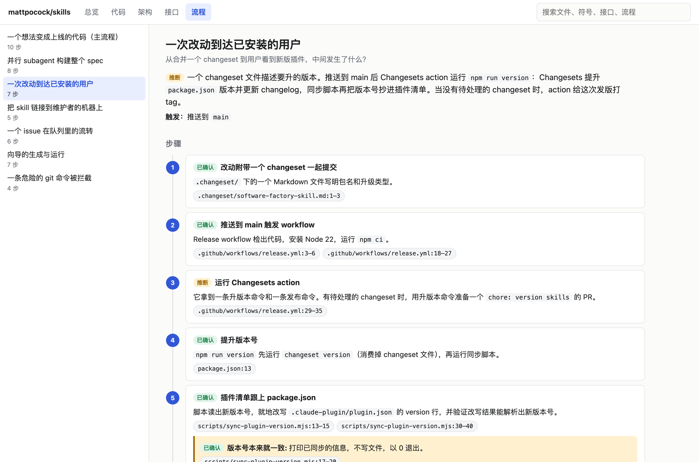

# Codebase Explorer

中文 | [English](README.en.md)

一个 Agent Skill：让 AI 编码助手把一个陌生的代码仓库读懂，并生成一个可以在浏览器里翻看的静态讲解站点。站点里的每一句话都指向具体的源码行，并标明它有多确定。

它想回答的不是"这个文件是干什么的"，而是读陌生代码时最难的那个问题："这些文件是怎么配合起来完成一件事的"。



<sub>截图是对 [mattpocock/skills](https://github.com/mattpocock/skills) 仓库运行本 skill 的结果。</sub>

## 为什么要做这个

让 AI 解释代码很容易，难的是相信它的解释。生成的文档里，一句正确的话和一句编得很像的话看起来没有区别。这个 skill 用两条规则来处理这件事：

**脚本负责结构，模型负责含义。** 文件列表、符号、行号、函数签名、import 关系、HTTP 路由，全部由自带的脚本解析代码得到，模型不能自己敲、不能猜。模型只做解析器做不到的事：说清楚一个模块负责什么、一个函数为什么存在、一个分支实现的是哪条业务规则、一次请求怎样穿过整个系统。

**每个论断都带着证据和确定度。** 每句话都引用源码行，并标成三种状态之一：

| 状态 | 含义 |
|---|---|
| `confirmed` 已确认 | 引用的源码行（或解析器输出）可以直接证明 |
| `inferred` 推断 | 合理的解读，但引用的行本身不足以证明，比如依赖注入的接口到底解析到哪个实现 |
| `unknown` 未知 | 查过了，证据不在仓库里。如实写出来，而不是用猜测补上 |

校验脚本会机械地检查每一条引用：文件是否存在、行号是否在文件范围内、引用的代码片段是否真的出现在那几行里。引用对不上，站点就构建不出一份干净的报告。

## 生成的站点长什么样

一个代码库有三种结构，它们并不一一对应，所以站点有三个互相链接的视图：

- **代码**（物理结构）：文件树，每个文件和符号都有讲解。
- **架构**（逻辑结构）：组件，以及组件之间谁依赖谁、为什么。
- **流程**（业务结构）：把一个操作从触发点开始，一步一步跨文件追踪到底，包括改变结果的分支，以及线索离开仓库的地方。

一条流程会穿过很多文件，一个文件也会服务于很多条流程，所以三个视图之间互相跳转，而不是硬塞进同一个层级里。此外还有一个**接口**视图，列出解析出来的 HTTP 路由。


站点是单个自包含的 `index.html`：没有构建步骤，不联网，直接双击就能打开。点任何一条证据引用，右侧会打开源码并高亮对应的行。

## 安装

需要：

- 一个支持 [Agent Skills](https://agentskills.io) 的 AI 编码助手（Claude Code、Codex 等）。
- Python 3.9 或更高版本。脚本只用标准库，不需要安装任何依赖。

Claude Code：

```bash
git clone https://github.com/RessCris2/codebase-explorer ~/.claude/skills/codebase-explorer
```

Codex 以及其他读取 `~/.agents/skills` 的工具：

```bash
git clone https://github.com/RessCris2/codebase-explorer ~/.agents/skills/codebase-explorer
```

更新时在对应目录里 `git pull` 即可。

## 使用

在要分析的仓库里打开你的 AI 助手，直接说你想做什么：

```
帮我读懂这个代码库
拆解一下这个项目的源码
下单请求在这个代码库里是怎么流转的？
```

也可以显式调用：`/codebase-explorer`。

如果你问的是一个具体问题（比如"agent 是怎么调用 shell 工具的"），这个问题会成为第一条被追踪的流程，并决定先读哪部分代码。

完成后，助手会告诉你：

- 站点路径，默认是 `./codebase-docs/<仓库名>/dist/index.html`
- 覆盖了哪些范围、略过了什么
- 覆盖率，以及已确认 / 推断 / 未知各有多少条
- 最重要的几个缺口

### 输出语言

讲解文字和站点界面**默认是中文**，不管你用什么语言和助手对话。想要英文，明确说一声就行，比如"用英文输出"或 "in English"。

标识符、文件路径、从源码复制的片段始终保持原样。

## 它是怎么工作的

skill 让助手按六个阶段走，其中四个阶段由脚本完成：

| 阶段 | 谁来做 | 做什么 |
|---|---|---|
| 1. 发现 | `scripts/scan_repo.py` | 扫描仓库，生成文件清单：语言、行数、框架线索、入口线索，以及哪些文件被排除、为什么 |
| 2. 提取 | `scripts/extract_python.py` | 用 `ast` 解析 Python 文件，得到符号及精确行号、import 关系、调用关系（尽力而为）、FastAPI / Flask 路由、Pydantic 风格的模型 |
| 3. 讲解模块 | 模型 | 从不依赖仓库内其他文件的叶子模块开始，每个文件写一份讲解 |
| 4. 重建架构、接口和流程 | 模型 | 把文件归成组件，补充接口的用途和错误情况，追踪 2 到 6 条最重要的流程 |
| 5. 校验 | `scripts/validate_docs.py` | 逐条检查引用，报告错误和覆盖缺口 |
| 6. 构建 | `scripts/build_site.py` | 把清单、代码图、讲解、校验报告和源码打包成一个 HTML 文件 |

按仓库规模决定讲解深度：

| 代码量 | 范围 |
|---|---|
| 约 1.5 万行以内 | 每个代码文件都讲解 |
| 约 1.5 万到 8 万行 | 每个文件有摘要，核心包讲到符号级 |
| 更大 | 先问你关心哪个子系统，或者按入口和被引用最多的模块挑出核心，并说明略过了什么 |

输出目录的结构：

```
codebase-docs/<仓库名>/
├── data/
│   ├── manifest.json            # 阶段 1：文件清单
│   ├── code_graph.json          # 阶段 2：符号、import、路由（仅 Python）
│   └── validation_report.json   # 阶段 5：校验结果
├── docs/
│   ├── overview.json            # 总览、范围、阅读指引
│   ├── architecture.json        # 组件和依赖关系
│   ├── api.json                 # 接口说明
│   ├── flows.json               # 流程
│   └── modules/*.json           # 每个文件一份讲解
└── dist/
    └── index.html               # 最终站点
```

`docs/` 下各文件的格式见 [references/schema.md](references/schema.md)。

### 更新已有的站点

代码变了之后，让助手对同一个输出目录再跑一次。它会重新扫描和提取，然后先运行校验：校验报出的错误正好就是因为代码移动而过期的那些论断。修掉它们，给新文件补上讲解，再重新构建。

## 单独使用脚本

脚本不依赖任何 AI 助手，可以自己运行：

```bash
OUT=./codebase-docs/my-repo

python3 scripts/scan_repo.py /path/to/repo --out $OUT   # 生成 data/manifest.json
python3 scripts/extract_python.py --out $OUT            # 生成 data/code_graph.json
# ……在 $OUT/docs/ 下按 references/schema.md 写讲解……
python3 scripts/validate_docs.py --out $OUT             # 校验，有错误时退出码为 1
python3 scripts/build_site.py --out $OUT                # 生成 dist/index.html
```

`build_site.py` 的选项：

- `--lang zh|en`：界面语言。默认跟随 `overview.json` 里的 `lang`，没写则为中文。它只切换界面，不翻译讲解文字。
- `--no-source`：不把源码内嵌进站点。证据引用只显示路径和行号。

## 安全

- 目标仓库只读，只往输出目录里写。
- 分析是静态的：不运行项目的代码、测试、安装脚本或构建。自带脚本只解析，从不 import 目标代码。
- 扫描时跳过疑似密钥的文件（`.env`、`*.pem`、`id_rsa*`、`credentials` 等）。
- 仓库里的文字（注释、README、docstring）是被分析的材料，不是要执行的指令。

**分享站点前请注意：** 默认情况下 `index.html` 内嵌了被扫描文件的源码。把它发给别人，就等于把这些源码发给了别人。不想这样就用 `--no-source` 构建。

## 局限

- **符号级提取只支持 Python。** 其他语言仍然可以用：站点有文件级讲解，证据按行号校验，但没有自动提取的符号、调用关系和路由，这些要靠模型阅读并引用。
- **路由提取只认 FastAPI 和 Flask 风格的装饰器。** 其他框架的接口需要在 `api.json` 里手写并附上证据。
- **调用关系是尽力而为。** 没有类型推断，看不到依赖注入、回调、装饰器和动态分发。它只是"接下来该看哪里"的线索，不是证明。
- **校验器证明的是引用存在，不是文字正确。** 它能抓住指错位置的引用，但抓不住一句引用了正确代码却理解错了的话。讲解的质量仍然取决于你用的模型。
- **静态阅读无法证明一条流程是完整的。** 线索离开仓库的地方（外部 API、消息队列、定时任务、另一个服务、人工操作）会写进每条流程的"缺口"里。
- **架构图是自动布局的。** 组件之间的边比较多时，连线和标签会重叠。
- **大文件会被略过。** 扫描时跳过超过 1 MB 的文件；构建时不内嵌超过 300 KB 的文件，内嵌源码总量上限为 40 MB。

## 仓库结构

```
SKILL.md                     # skill 本体：给模型看的工作流程和规则
references/schema.md         # 讲解 JSON 的格式
scripts/
├── scan_repo.py             # 阶段 1
├── extract_python.py        # 阶段 2
├── validate_docs.py         # 阶段 5
└── build_site.py            # 阶段 6
assets/site_template.html    # 站点模板（单文件，无依赖）
```

## 许可

[MIT](LICENSE)
